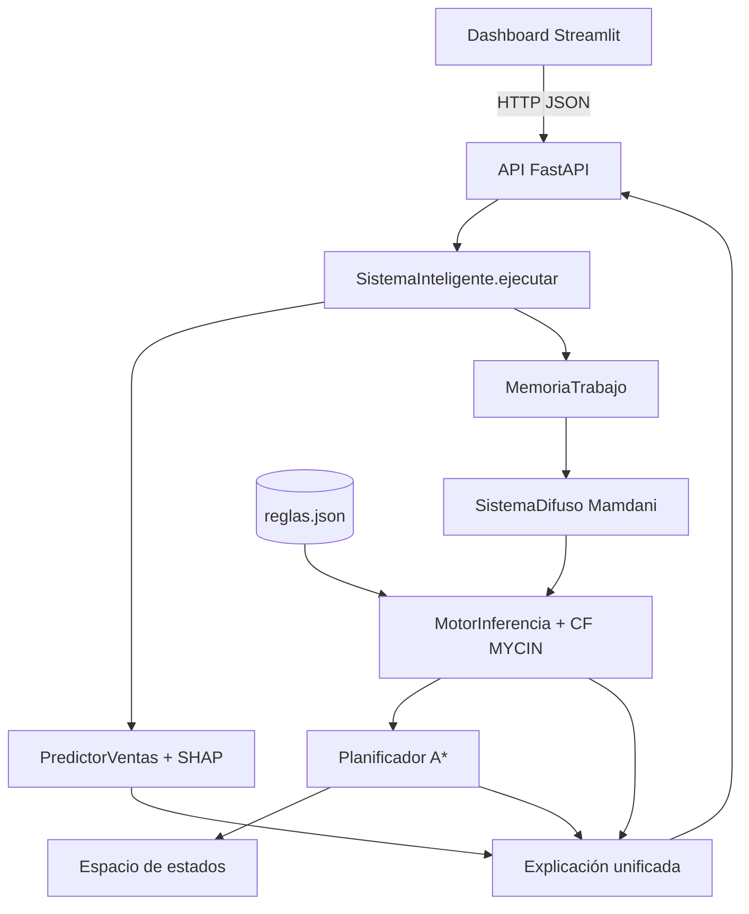
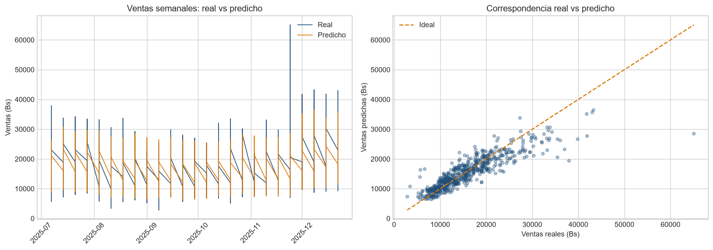
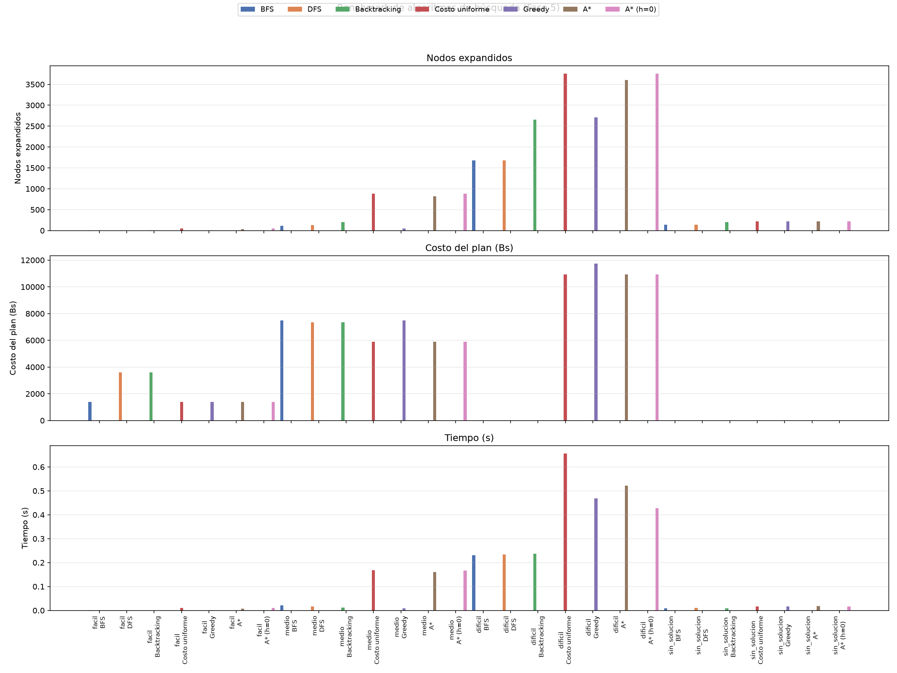
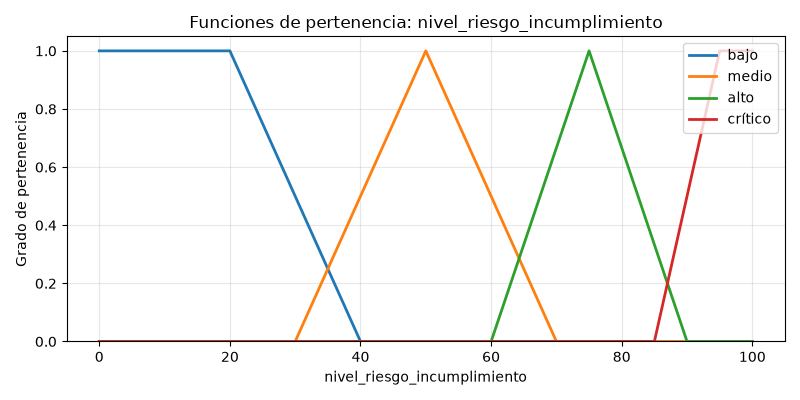

# Sistema inteligente de predicción del rendimiento de ventas

Sistema híbrido **neuro-simbólico** que predice las ventas semanales y el
cumplimiento de metas de una cadena de retail de alimentos en Bolivia (pollo,
cerdo, embutidos y congelados), diagnostica las causas de incumplimiento,
gradúa el riesgo, planifica acciones y explica cada decisión.

Combina un modelo de Machine Learning calibrado con un sistema experto basado
en reglas y factores de certeza, lógica difusa Mamdani y búsqueda en espacios de
estados (BFS, DFS, backtracking, Greedy, A* y Minimax). Todo se integra en una
fachada única, se expone por API REST y se visualiza en un dashboard Streamlit.

---

## Índice

- [Estado del proyecto](#estado-del-proyecto)
- [Arquitectura](#arquitectura)
- [Requisitos e instalación](#requisitos-e-instalación)
- [Inicio rápido](#inicio-rápido)
- [Uso paso a paso](#uso-paso-a-paso)
- [API REST](#api-rest)
- [Dashboard](#dashboard)
- [Pruebas y calidad](#pruebas-y-calidad)
- [Estructura del repositorio](#estructura-del-repositorio)
- [Capturas](#capturas)
- [Documentación académica](#documentación-académica)
- [Solución de problemas](#solución-de-problemas)

---

## Estado del proyecto

| Fase | Alcance | Estado |
| ---- | ------- | ------ |
| 1 | Configuración base y generación del dataset | Completada |
| 2 | Preprocesamiento y modelo de Machine Learning | Completada |
| 3 | Sistema experto (reglas y factores de certeza) | Completada |
| 4 | Lógica difusa e integración con el sistema experto | Completada |
| 5 | Búsqueda y planificación de acciones comerciales | Completada |
| 6 | Orquestador que integra todos los componentes | Completada |
| 7 | API REST con FastAPI y dashboard con Streamlit | Completada |
| 8 | Documentación académica, calidad y cierre | Completada |

---

## Arquitectura



**Principios de diseño**

- `SistemaInteligente.ejecutar(contexto)` es el único punto de entrada de
  negocio; la API solo proyecta partes del resultado.
- Todas las dependencias se inyectan por constructor. `core/fabrica.py` es el
  único lugar donde se instancian modelo, reglas, memoria, motor, difuso y A*.
- Cada petición HTTP construye una fachada nueva porque la memoria de trabajo
  acumula hechos. No hay globales mutables.
- Las reglas (38) y los parámetros difusos (7 variables, 22 reglas) son datos
  declarativos en `expert_system/reglas.json` y `config.py`.
- El dashboard es un cliente ligero: **no duplica lógica de negocio**.

---

## Requisitos e instalación

- **Python 3.11 o superior** (validado con Python 3.11.9).
- Conexión a Internet para la primera instalación de paquetes.
- Sistema operativo Windows, Linux o macOS. Los comandos siguientes usan
  PowerShell; en Linux/macOS cambie `venv\Scripts\` por `venv/bin/`.

Desde la raíz del repositorio:

```powershell
python -m venv venv
.\venv\Scripts\Activate.ps1
python -m pip install --upgrade pip
pip install -r requirements.txt
pip install -r requirements-dev.txt
```

Ambos archivos fijan **todas** las versiones (`==`) para que la instalación sea
reproducible. `requirements.txt` contiene el stack de ejecución;
`requirements-dev.txt` añade black, ruff, mypy, pytest y pytest-cov.

Si PowerShell bloquea la activación, ejecute una vez:

```powershell
Set-ExecutionPolicy -Scope CurrentUser RemoteSigned
```

---

## Inicio rápido

Con el entorno activado y las dependencias instaladas:

```powershell
# 1. Generar el dataset simulado (2 496 filas, semilla 2026)
python -m data.generar_dataset

# 2. Entrenar y guardar el modelo junto con sus métricas y figuras
python -m ml.entrenamiento

# 3. Ver los tres casos representativos de extremo a extremo
python -m core.demo

# 4. Ejecutar la batería de pruebas
pytest
```

Tras el paso 2 deben existir `data/raw/ventas_semanales.csv`,
`models/predictor_ventas.joblib` y los artefactos en `docs/`.

---

## Uso paso a paso

### 1. Datos y análisis exploratorio

```powershell
python -m data.generar_dataset --semilla 2026 --salida data/raw/ventas_semanales.csv
python -m notebooks.eda_ventas
```

La meta se fija antes de vender, se inyecta 2 % de faltantes y 1,5 % de choques
atípicos. El esquema completo está al final de este README.

### 2. Modelo de Machine Learning

```powershell
python -m ml.entrenamiento --semilla 2026
```

Convención: la fila `t` predice la venta de `t+1`; los lags y medias móviles usan
solo semanas cerradas y el calendario corresponde a la semana objetivo. El corte
temporal deja el entrenamiento hasta 2025-06-30. Se comparan Ridge, Random
Forest, Gradient Boosting, MLPRegressor y una línea base; se selecciona por MAE.

| Modelo | MAE | RMSE | R² | MAPE |
| ------ | --- | ---- | -- | ---- |
| **Ridge (seleccionado)** | **2 298,48** | **3 488,88** | **0,7627** | **15,14 %** |
| Gradient Boosting | 2 417,25 | 3 660,97 | 0,7387 | 15,79 % |
| Random Forest | 2 465,73 | 3 587,84 | 0,7490 | 16,29 % |
| MLPRegressor | 2 485,65 | 3 650,86 | 0,7401 | 16,35 % |
| Baseline (semana anterior) | 3 013,05 | 4 496,60 | 0,6058 | 19,71 % |

Mejora frente a la línea base: **23,72 % de MAE**.

```python
from ml.predictor import PredictorVentas

predictor = PredictorVentas()
resultado = predictor.predecir({"historial": historial_de_la_serie})
print(resultado.valor_predicho, resultado.confianza, resultado.principales_factores)
```

### 3. Sistema experto y factores de certeza

```powershell
python -m expert_system.demo
```

```python
from expert_system.base_conocimientos import BaseConocimientos
from expert_system.demo import hechos_del_caso
from expert_system.explicacion import explicar
from expert_system.motor_inferencia import MotorInferencia

base = BaseConocimientos.desde_json()
memoria = hechos_del_caso()
traza = MotorInferencia(base, memoria).encadenar_adelante(memoria)
accion = memoria.consultar("accion_recomendada")
print(explicar("accion_recomendada", accion.valor, base, traza, memoria).a_texto())
```

### 4. Lógica difusa

```powershell
python -m expert_system.logica_difusa
python -m expert_system.demo   # mismo caso con y sin difuso
```

```python
from expert_system.logica_difusa import SistemaDifuso

sistema = SistemaDifuso()
resultado = sistema.calcular({
    "cumplimiento_esperado_pct": 82.0,
    "stock_cobertura": 0.12,
    "merma_pct": 14.5,
    "afluencia_rel": 0.72,
    "descuento_pct": 0.0,
})
print(resultado.descripcion())
```

Las figuras de las siete funciones de pertenencia se guardan en
`docs/figuras/pertenencia_*.png`.

### 5. Búsqueda y planificación

```python
from search.espacio_estados import ProblemaPlanComercial
from search.informada import a_estrella

problema = ProblemaPlanComercial(
    meta_bs=24_000.0, presupuesto_bs=9_000.0, stock_inicial=400, merma_inicial=12.0
)
resultado = a_estrella(problema)
print(resultado.descripcion_plan, resultado.costo, resultado.nodos_expandidos)
```

```powershell
python -m search.benchmark
```

El benchmark genera `docs/benchmark_busqueda.csv`, `.md` y la figura comparativa.
A* coincide con costo uniforme en los seis escenarios con solución; en
`dificil` expande 3 600 nodos frente a 3 756 de `A* (h=0)`.

### 6. Flujo completo de la fachada

```python
from core.fabrica import construir_contexto_desde_csv, construir_sistema

sistema = construir_sistema()
contexto = construir_contexto_desde_csv(
    "El Alto", "pollo", factor_meta=1.20, stock_cobertura=0.18
)
resultado = sistema.ejecutar(contexto)

print(resultado.resumen())
print(resultado.explicacion)
print(resultado.comparativa.a_texto())
```

Tres casos listos para demostrar:

```powershell
python -m core.demo
```

### 7. API y dashboard

```powershell
# Terminal 1
.\venv\Scripts\python.exe -m uvicorn api.main:app --reload --host 0.0.0.0 --port 8000

# Terminal 2
.\venv\Scripts\python.exe -m streamlit run app/dashboard.py --server.port 8501
```

Abra <http://localhost:8501>. Documentación interactiva de la API:
<http://localhost:8000/docs> y <http://localhost:8000/redoc>.

---

## API REST

| Método | Endpoint | Descripción |
| ------ | -------- | ----------- |
| `POST` | `/predecir` | Predicción, confianza, factores SHAP, histórico y proyección. |
| `POST` | `/diagnosticar` | Causas con factor de certeza, riesgo difuso y semáforo. |
| `POST` | `/planificar` | Plan de A* con costo, restricciones y justificación. |
| `POST` | `/analisis-completo` | Respuesta integral consumida por el dashboard. |
| `GET` | `/explicar/{id}` | Explicación de un análisis guardado, recuperada por UUID. |
| `GET` | `/salud` | Estado del servicio y de los artefactos requeridos. |
| `GET` | `/catalogos` | Sucursales, categorías y temporadas del dominio. |
| `GET` | `/benchmark` | Métricas del benchmark de búsqueda. |

Ejemplo:

```powershell
curl -X POST http://localhost:8000/analisis-completo ^
  -H "Content-Type: application/json" ^
  -d "{\"sucursal\":\"El Alto\",\"categoria\":\"pollo\",\"factor_meta\":1.2}"
```

CORS permite por defecto `http://localhost:8501` y `http://127.0.0.1:8501`.
Se puede cambiar con `$env:API_CORS_ORIGINS = "http://localhost:8501,http://localhost:3000"`.

---

## Dashboard

La interfaz permite elegir sucursal y categoría, ajustar el escenario
(factor de meta, cobertura de stock, afluencia, merma, precio frente a la
competencia) y muestra:

- histórico real frente a la proyección;
- semáforo de riesgo y causas con barras de certeza;
- plan de acciones con costo y restricciones;
- explicación con gráfico SHAP;
- pestañas de comparación de algoritmos, traza de reglas y comparativa
  simbólico vs. no simbólico.

La URL de la API se cambia en la barra lateral; por defecto es
`http://localhost:8000`.

---

## Pruebas y calidad

```powershell
black --check .
ruff check .
mypy
pytest --cov=. --cov-report=term-missing
```

Resultados del cierre de Fase 8:

| Comprobación | Resultado |
| ------------ | --------- |
| `black --check .` | 64 archivos sin cambios |
| `ruff check .` | Sin incidencias |
| `mypy` | Sin incidencias en 39 archivos |
| `pytest` | 262 pruebas superadas |
| Cobertura total | 91 % |
| Cobertura `expert_system/` | 97 % |
| Cobertura `search/` | 97 % |

Para solo los paquetes exigidos por la materia:

```powershell
pytest --cov=expert_system --cov=search --cov-report=term-missing
```

---

## Estructura del repositorio

```text
sistema_prediccion/
├── config.py                    # Rutas, semilla, catálogos y parámetros del dominio
├── data/
│   ├── generar_dataset.py       # Simulador de ventas semanales
│   ├── raw/                     # Dataset crudo generado (CSV)
│   └── processed/               # Datasets limpios y transformados
├── ml/                          # Preprocesamiento, entrenamiento, evaluación y SHAP
├── models/                      # Modelos entrenados (joblib)
├── expert_system/               # Reglas, memoria, motor, CF y lógica difusa
│   └── reglas.json              # 38 reglas declarativas
├── search/                      # Espacio de estados y planificación
│   ├── espacio_estados.py       # Problema, EstadoPlan, operadores y heurística
│   ├── resultado.py             # Resultado común de los algoritmos
│   ├── no_informada.py          # BFS, DFS, backtracking y costo uniforme
│   ├── informada.py             # Greedy, A* y heurística trivial
│   ├── minimax.py               # Competidor, Minimax y alfa-beta
│   └── benchmark.py             # Escenarios, tablas y gráfico
├── core/                        # Fachada de integración
│   ├── contexto.py              # Contexto tipado y hechos observados
│   ├── resultado.py             # Salidas tipadas y comparativa Tema 1
│   ├── puertos.py               # Protocolos de dependencias
│   ├── planificador.py          # A* parametrizado por el diagnóstico
│   ├── explicacion.py           # Explicación unificada en español
│   ├── sistema.py               # SistemaInteligente.ejecutar
│   ├── fabrica.py               # Composition root
│   └── demo.py                  # Tres casos representativos
├── api/                         # API FastAPI (Fase 7)
│   ├── main.py                  # crear_app(), endpoints, CORS y errores
│   ├── esquemas.py              # Modelos Pydantic estrictos
│   ├── dependencias.py          # Servicio y repositorio desde app.state
│   └── mapeado.py               # Proyección del resultado de núcleo a API
├── app/dashboard.py             # Dashboard Streamlit
├── notebooks/eda_ventas.py      # Análisis exploratorio
├── tests/                       # Pruebas con pytest
├── docs/                        # Documentación y artefactos
│   ├── commonkads.md            # Los seis modelos CommonKADS
│   ├── informe.md               # Informe técnico y trazabilidad
│   ├── guion_demo.md            # Guion de demostración de 10 minutos
│   ├── metricas_modelo.json     # Métricas y calibración
│   ├── benchmark_busqueda.md    # Tablas y verificación de optimalidad
│   └── figuras/                 # Gráficos generados
├── requirements.txt             # Dependencias de ejecución fijadas
├── requirements-dev.txt         # Herramientas de desarrollo fijadas
└── pyproject.toml               # Configuración de black, ruff, pytest y mypy
```

---

## Capturas

**Predicción frente a valor real y residuos del modelo seleccionado**



**Comparativa de algoritmos de búsqueda**



**Función de pertenencia del riesgo difuso**



**Dashboard en ejecución**

El dashboard se muestra en vivo siguiendo los comandos de la sección
[API y dashboard](#7-api-y-dashboard). Las capturas estáticas incluidas en
`docs/figuras/` corresponden a las figuras generadas por el pipeline.

---

## Documentación académica

| Documento | Contenido |
| --------- | --------- |
| [`docs/commonkads.md`](docs/commonkads.md) | Modelos de organización, tareas, agentes, conocimiento (38 reglas), comunicación y diseño; adquisición con fuentes simuladas. |
| [`docs/informe.md`](docs/informe.md) | Informe técnico completo, resultados y tabla de trazabilidad Temas 1-3. |
| [`docs/guion_demo.md`](docs/guion_demo.md) | Guion de demostración en vivo de 10 minutos. |
| [`docs/metricas_modelo.json`](docs/metricas_modelo.json) | Métricas, calibración y columnas del modelo. |
| [`docs/benchmark_busqueda.md`](docs/benchmark_busqueda.md) | Resultados del benchmark y verificación de optimalidad. |

---

## Dataset generado

`data/raw/ventas_semanales.csv` contiene 2 496 filas (104 semanas × 6 sucursales
× 4 categorías) con este esquema:

| Columna | Descripción |
| ------- | ----------- |
| `fecha_semana` | Lunes que inicia la semana |
| `sucursal` | Sopocachi, El Alto, Miraflores, Calacoto, Obrajes o San Pedro |
| `categoria` | pollo, cerdo, embutidos o congelados |
| `ventas_bs` | Ventas de la semana en bolivianos |
| `unidades_vendidas` | Unidades efectivamente vendidas |
| `precio_promedio` | Precio unitario realizado (con descuento aplicado) |
| `en_promocion` | Indica si la semana tuvo promoción |
| `descuento_pct` | Descuento aplicado (0 si no hubo promoción) |
| `stock_inicial` | Unidades disponibles al inicio de la semana |
| `merma_pct` | Porcentaje de stock perdido por merma |
| `temporada` | alta, media o baja |
| `es_feriado_semana` | La semana contiene un feriado boliviano |
| `temperatura_media` | Temperatura media semanal (°C) |
| `afluencia_clientes` | Clientes que ingresaron a la sucursal |
| `personal_asignado` | Personas asignadas a la categoría |
| `meta_ventas_bs` | Meta semanal fijada antes de vender |
| `cumplimiento_meta_pct` | `ventas_bs / meta_ventas_bs × 100` |

---

## Solución de problemas

| Síntoma | Causa probable | Solución |
| ------- | -------------- | -------- |
| `ModuleNotFoundError` | Entorno no activado o dependencias incompletas | Active `venv` y reinstale ambos `requirements*.txt`. |
| Falta `ventas_semanales.csv` | No se generó el dataset | `python -m data.generar_dataset`. |
| Falta `predictor_ventas.joblib` | No se entrenó el modelo | `python -m ml.entrenamiento`. |
| El dashboard no muestra datos | API apagada o URL incorrecta | Inicie uvicorn en el puerto 8000 y revise la barra lateral. |
| Error 503 `/salud` | Artefactos requeridos ausentes | Genere dataset, entrene modelo y verifique `reglas.json`. |
| `pytest` con pocas pruebas | Se ejecuta desde otra carpeta | Ejecute siempre desde la raíz del repositorio. |

---

**Licencia / uso académico.** Proyecto desarrollado como trabajo de Inteligencia
Artificial. Los datos y expertos son simulados; véanse las limitaciones en
`docs/informe.md`.
