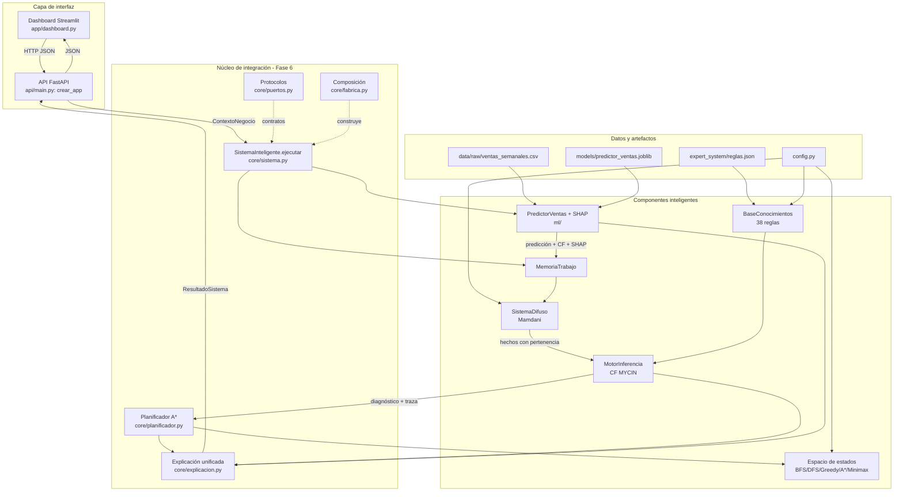

# Informe técnico del proyecto

**Sistema inteligente híbrido de predicción del rendimiento de ventas y apoyo a
la decisión comercial**

- Versión: 1.0 (cierre de Fase 8)
- Fecha: 20 de noviembre de 2026
- Semilla de reproducción: 2026
- Repositorio: `sistema_prediccion`

---

## 1. Introducción

Una cadena de retail de alimentos en Bolivia necesita decidir cada semana, para
cada sucursal y categoría (pollo, cerdo, embutidos y congelados), si repondrá
inventario, lanzará una promoción, reasignará stock o mantendrá el plan. Esa
decisión depende de dos fuentes de conocimiento muy distintas: un modelo
estadístico capaz de estimar la venta siguiente a partir de series temporales,
y el criterio de supervisores que saben interpretar quiebres de stock, mermas,
afluencia y precios de la competencia.

Este proyecto construye un sistema **neuro-simbólico** que combina ambas fuentes.
El componente no simbólico predice y explica la cifra; el componente simbólico
diagnostica causas con factores de certeza, gradúa el riesgo con lógica difusa,
busca un plan de acción y produce una explicación auditable. Todo se expone
mediante una API REST y un dashboard.

El informe cubre el problema, el marco teórico de los Temas 1 a 3 de la
asignatura, la metodología, la arquitectura, la implementación, los resultados
experimentales, la discusión sobre el equilibrio entre lo simbólico y lo no
simbólico, las limitaciones y el trabajo futuro.

---

## 2. Problema y contexto

El problema central es la **falta de integración entre predicción y decisión**:

1. Un modelo de regresión entrega un número, pero no indica *por qué* se espera
   ese valor ni *qué hacer* al respecto.
2. El criterio experto suele estar en reglas informales ("si hay merma alta, no
   pidas más") y no se registra de forma verificable.
3. La incertidumbre aparece mezclada: el modelo tiene error, los datos pueden
   ser incompletos y los conceptos del negocio ("riesgo alto", "stock crítico")
   son borrosos.
4. Sin traza de inferencia, un plan automático es difícil de auditar y de
   discutir con el supervisor.

**Contexto operativo.** Se simulan 104 semanas de ventas para 6 sucursales
(Sopocachi, El Alto, Miraflores, Calacoto, Obrajes, San Pedro) y 4 categorías,
con 2 496 filas. La meta se fija antes de vender para evitar fuga de
información; se inyecta 2 % de valores faltantes y choques atípicos en 1,5 %
de las filas. El detalle está en `README.md` y `data/generar_dataset.py`.

---

## 3. Objetivos

### 3.1 Objetivo general

Diseñar e implementar un sistema inteligente híbrido que prediga ventas,
razone sobre las causas de incumplimiento, gradúe el riesgo, proponga un plan
de acciones y explique cada una de esas decisiones, cumpliendo los contenidos
de los Temas 1, 2 y 3.

### 3.2 Objetivos específicos

1. Generar un dataset simulado reproducible y realizar el análisis
   exploratorio correspondiente.
2. Entrenar y comparar modelos de regresión con validación temporal, obteniendo
   un modelo calibrado con métricas verificables.
3. Construir un sistema experto declarativo con base de conocimientos, memoria
   de trabajo, motor de inferencia y módulo de explicación.
4. Incorporar factores de certeza estilo MYCIN y lógica difusa Mamdani para
   tratar incertidumbre e imprecisión.
5. Modelar el problema de planificación como un espacio de estados y comparar
   búsquedas no informadas, informadas y Minimax con poda alfa-beta.
6. Integrar todos los componentes mediante una fachada con inyección de
   dependencias.
7. Exponer el sistema por API REST y dashboard, con documentación académica
   (CommonKADS e informe) y aseguramiento de calidad.

---

## 4. Marco teórico breve

### 4.1 Tema 1. Fundamentos de IA

- **IA simbólica frente a no simbólica.** La IA simbólica manipula símbolos
  explícitos con reglas lógicas (producciones, marcos, grafos); es transparente
  y auditable, pero frágil ante datos ruidosos. La IA no simbólica (aquí,
  regresión y redes neuronales) aprende patrones de los datos; es robusta y
  precisa, pero su decisión es opaca. El enfoque híbrido conserva la precisión
  predictiva y añade razonamiento y explicación.
- **Aprendizaje automático.** Se entrena una regresión lineal regularizada
  (Ridge) con validación temporal `TimeSeriesSplit` y se comparan Random
  Forest, Gradient Boosting y MLPRegressor frente a una línea base.
- **Representación del conocimiento.** Hechos tipados con factor de certeza,
  reglas de producción declarativas en JSON, variables lingüísticas y trazas
  de inferencia.
- **Incertidumbre.** Se distinguen dos fenómenos: duda episémica (factor de
  certeza MYCIN) e imprecisión semántica (pertenencia difusa).
- **Explicabilidad.** SHAP explica la predicción local; la traza explica las
  reglas; el centroide y las pertenencias explican el riesgo; A* explica el
  plan. `comparativa_componentes` documenta la colaboración de ambos mundos.

### 4.2 Tema 2. Problemas, representación y búsqueda

- **Espacio de estados.** `EstadoPlan` es una tupla inmutable de stock,
  descuento, personal, merma, ventas proyectadas y presupuesto restante.
  `ProblemaPlanComercial` define inicial, prueba de meta, acciones, sucesor y
  costo.
- **No informadas.** `busqueda_amplitud` (BFS, completa y de plan más corto),
  `busqueda_profundidad` (DFS), `backtracking` con control global de estados y
  `costo_uniforme` (Dijkstra, óptimo con costos heterogéneos).
- **Informadas.** `busqueda_voraz` (Greedy, rápida pero no óptima) y
  `a_estrella` con heurística `h = max(c_min·ceil(déficit/G), déficit/E)`,
  demostrablemente admisible y consistente. `heuristica_cero` permite medir su
  aporte.
- **Minimax opcional.** `search/minimax.py` modela la respuesta del competidor
  y verifica que `_alfa_beta` devuelve el mismo valor que `_minimax` con menos
  nodos.

### 4.3 Tema 3. Ingeniería del conocimiento

- **Sistema experto completo.** Base de conocimientos (`BaseConocimientos`),
  memoria de trabajo (`MemoriaTrabajo`), motor (`MotorInferencia` con
  encadenamiento hacia adelante y hacia atrás) y módulo de explicación
  (`explicar`).
- **Factores de certeza.** `min`/`max` para grupos de condiciones, producto
  para propagar y fórmulas de combinación para evidencia convergente.
- **Lógica difusa.** `SistemaDifuso` implementa Mamdani con 5 entradas, 2
  salidas, 22 reglas y defuzzificación por centroide.
- **CommonKADS simplificado.** Los seis modelos (organización, tareas,
  agentes, conocimiento, comunicación y diseño) se documentan en
  `docs/commonkads.md`, incluida la adquisición con fuentes simuladas.

---

## 5. Metodología

El trabajo se desarrolló en ocho fases incrementales:

| Fase | Entregable principal | Verificación |
| ---- | -------------------- | ------------ |
| 1 | Dataset simulado y EDA | Reproducibilidad con semilla 2026 |
| 2 | Preprocesamiento y modelo ML | Comparación temporal de modelos y calibración |
| 3 | Sistema experto y CF | Pruebas de reglas, CF y explicación |
| 4 | Lógica difusa | Figuras de pertenencia y demostración con/sin difuso |
| 5 | Búsqueda y planificación | Benchmark y prueba de optimalidad |
| 6 | Fachada `SistemaInteligente` | Tres flujos reales de extremo a extremo |
| 7 | API FastAPI y dashboard Streamlit | Pruebas HTTP y render con `AppTest` |
| 8 | Documentación y calidad | black, ruff, mypy, pytest con cobertura, instalación limpia |

**Decisiones de diseño relevantes.**

- El núcleo se programa con `Protocol` en `core/puertos.py`; las dependencias se
  inyectan en el constructor y se construyen en `core/fabrica.py`.
- `SistemaInteligente.ejecutar(contexto)` es el único método público de
  negocio; la API solo proyecta subconjuntos del resultado.
- Cada petición HTTP crea una fachada nueva porque la memoria acumulahechos;
  el repositorio de explicaciones usa UUID en memoria.
- Las reglas y los parámetros difusos son datos (`reglas.json`, `config.py`),
  no código, para facilitar su revisión por el experto.

---

## 6. Arquitectura

**Flujo de una petición.** `POST /analisis-completo` → validación Pydantic →
`ContextoNegocio` → `SistemaInteligente.ejecutar` → ML → hechos con CF →
fuzzificación → inferencia → A* → explicación → proyección a JSON → dashboard.

---

## 7. Implementación por módulo

### 7.1 `data/` y `notebooks/`

`data/generar_dataset.py` produce el dataset con estacionalidad, feriados,
promociones, merma, stock limitante, valores faltantes y choques atípicos.
`notebooks/eda_ventas.py` genera las figuras exploratorias. `config.py` centraliza
rutas, semilla, catálogos y constantes.

### 7.2 `ml/`

`preprocesamiento.py` construye lags (1, 2, 4), medias móviles (2, 4, 8) y
variables de calendario de la semana objetivo; separa numéricas y categóricas
en un `ColumnTransformer`. `entrenamiento.py` ejecuta la búsqueda de
hiperparámetros y la comparación de modelos, guarda métricas y tablas.
`predictor.py` carga el artefacto y devuelve valor, confianza calibrada y
factores SHAP. `explicabilidad.py` implementa SHAP global y local.

### 7.3 `expert_system/`

`base_conocimientos.py` carga y valida 38 reglas; `memoria_trabajo.py` guarda
hechos con CF, origen y justificación; `factores_certeza.py` implementa la
aritmética MYCIN; `motor_inferencia.py` hace encadenamiento hacia adelante y
hacia atrás con resolución de conflictos; `logica_difusa.py` construye el
sistema Mamdani y expone `fuzzificar`; `explicacion.py` genera explicaciones
"POR QUÉ / CÓMO" a partir de la traza.

### 7.4 `search/`

`espacio_estados.py` define el problema y los operadores (promoción por
niveles, reposición, reasignación, refuerzo de personal y reducción de merma).
`no_informada.py` e `informada.py` implementan los algoritmos y un `Resultado`
común. `minimax.py` modela al competidor. `benchmark.py` genera los escenarios
y los artefactos en `docs/`.

### 7.5 `core/`

`contexto.py` tipa la entrada; `resultado.py` tipa la salida y construye la
comparativa Tema 1; `planificador.py` convierte causas en restricciones y llama
a A*; `explicacion.py` compone las cinco secciones; `sistema.py` orquesta;
`fabrica.py` es la única composición raíz; `demo.py` muestra tres casos.

### 7.6 `api/` y `app/`

`api/main.py:crear_app` construye la aplicación sin globales mutables;
`api/dependencias.py` inyecta servicio y repositorio desde `app.state`;
`api/esquemas.py` define contratos estrictos; `api/mapeado.py` proyecta el
resultado. `app/dashboard.py` es un cliente Streamlit que consume la API y
muestra primero la decisión semanal y cuatro cifras de contexto; el histórico,
el riesgo, las causas, la explicación SHAP, la traza real de estados, las reglas
y la comparativa quedan en tres apartados desplegables. El resumen para la
presentación está en [`INFORME.md`](INFORME.md).

---

## 8. Resultados

### 8.1 Resultados de Machine Learning

Métricas en el conjunto de prueba (corte temporal 2025-06-30), semilla 2026:

| Modelo | MAE | RMSE | R² | MAPE |
| ------ | --- | ---- | -- | ---- |
| **Ridge (seleccionado)** | **2 298,48** | **3 488,88** | **0,7627** | **15,14 %** |
| Gradient Boosting | 2 417,25 | 3 660,97 | 0,7387 | 15,79 % |
| Random Forest | 2 465,73 | 3 587,84 | 0,7490 | 16,29 % |
| MLPRegressor | 2 485,65 | 3 650,86 | 0,7401 | 16,35 % |
| Baseline (semana anterior) | 3 013,05 | 4 496,60 | 0,6058 | 19,71 % |

El modelo seleccionado reduce el MAE de la línea base en **23,72 %**. La
confianza calibrada se estima a partir del desvío de residuos relativos
(0,2338) y el MAPE de prueba (15,14 %); se usa como factor de certeza de los
hechos inyectados por el modelo. Artefactos: `docs/metricas_modelo.json`,
`docs/comparacion_modelos.md`, `docs/importancia_variables.csv` y
`docs/figuras/real_vs_predicho.png`, `residuos.png`.

### 8.2 Benchmark de búsqueda

| Escenario | BFS | DFS | Backtracking | Costo uniforme | Greedy | A* | A* (h=0) |
| --------- | --- | --- | ------------ | -------------- | ------ | -- | -------- |
| fácil (costo Bs / nodos) | 1 400 / 4 | 3 600 / 5 | 3 600 / 5 | 1 400 / 49 | 1 400 / 2 | 1 400 / 35 | 1 400 / 49 |
| medio (costo Bs / nodos) | 7 500 / 114 | 7 350 / 135 | 7 350 / 203 | 5 900 / 880 | 7 500 / 51 | 5 900 / 819 | 5 900 / 880 |
| difícil (costo Bs / nodos) | sin solución | sin solución | sin solución | 10 920 / 3 756 | 11 740 / 2 706 | 10 920 / 3 600 | 10 920 / 3 756 |

Puntos destacables:

- BFS encuentra el plan más corto, no el más barato; DFS y backtracking son
  incluso más costosos en el escenario fácil.
- Greedy expande pocos nodos pero pierde optimalidad en el escenario difícil
  (11 740 Bs frente a 10 920 Bs).
- A* coincide con costo uniforme en los **6 escenarios con solución**, lo que
  verifica empíricamente su optimalidad. En `dificil` expande 3 600 nodos
  frente a 3 756 de `A* (h=0)`: la heurística ahorra 156 expansiones (~4,2 %).
- En `sin_solucion` todos los algoritmos agotan la frontera y devuelven
  `encontrado=False` sin planes espurios.

Datos completos: `docs/benchmark_busqueda.csv`, `docs/benchmark_busqueda.md` y
`docs/figuras/benchmark_busqueda.png`.

### 8.3 Ejemplos de explicación

**Caso 1 — Sucursal en riesgo (El Alto / pollo).** El sistema predice
35 740,90 Bs (67,0 % de la meta) con confianza 0,24. SHAP señala como
principales aportes `ventas_media_8` (+3 628 Bs), `meta_ventas_bs` (+3 543 Bs) y
`afluencia_clientes` (−3 360 Bs). El motor dispara 12 reglas; las causas con
mayor certeza son `operacion_critica` (CF +0,880, D10), `merma_alta` (+0,850,
D03) y `stock_critico` (+0,215, D01). La lógica difusa confirma riesgo alto y
urgencia alta; A* propone `reponer_stock(+400u)` por 4 400 Bs tras expandir
29 nodos. La explicación incluye la cadena completa "POR QUÉ / CÓMO" con el CF
de premisa y propagado de cada regla.

**Caso 2 — Sucursal normal (Sopocachi / cerdo).** Predicción de 21 374,80 Bs
(123,1 % de la meta), sin causas por encima del umbral, riesgo bajo y plan
`sin acciones (la meta ya se alcanza)` con costo 0 Bs (1 nodo expandido). El
sistema no fuerza una recomendación cuando no hay problema.

**Caso 3 — Exceso de stock (Miraflores / embutidos).** Predicción de 17 658,76
Bs (122,9 %), causa `exceso_stock` con CF +0,331 y plan `reducir_merma(-2pp)`
por 220 Bs (2 nodos). La restricción derivada impide traer más inventario de
otra sucursal; se ataca la merma en lugar de reforzar el pedido.

Estos casos se reproducen con `python -m core.demo` y sirven de guion para
`docs/guion_demo.md`.

### 8.4 Calidad del software

Ver sección 11: 262 pruebas, cobertura 91 % global, 97 % en `expert_system/`
y 97 % en `search/`, black/ruff/mypy sin incidencias.

---

## 9. Discusión: simbólico versus no simbólico

| Dimensión | No simbólico (Ridge + SHAP) | Simbólico (reglas + difuso + A*) |
| --------- | --------------------------- | -------------------------------- |
| Entrada | Serie histórica y variables numéricas/categóricas | Hechos, reglas y variables lingüísticas |
| Salida | Valor continuo y atribución | Causas, riesgo, plan y traza |
| Incertidumbre | Confianza calibrada y residuos | CF MYCIN y grados de pertenencia |
| Explicación | "Qué variables influyeron y cuánto" | "Qué regla se disparó y con qué certeza" |
| Fortaleza | Precisión y generalización | Transparencia y control del experto |
| Debilidad | Opacidad relativa; no decide acciones | Depende de la calidad de las reglas |

La integración no es una simple suma: la confianza del modelo se convierte en
el CF inicial de los hechos derivados, de modo que una predicción dudosa debilita
las conclusiones simbólicas. A su vez, el diagnóstico simbólico restringe el
espacio de búsqueda de A*: una causa de merma alta elimina operadores
inadecuados. SHAP y la traza se presentan juntos en `explicacion_unificada`, y
`comparativa_componentes` explica al usuario qué aporta cada paradigma.

**Resultado observado.** En el caso en riesgo, la confianza baja (0,24) impide
que `stock_critico` alcance un CF alto (0,215), mientras que la regla crisp D10,
basada en datos observados con CF 1,0, domina el diagnóstico (0,880). Esto
muestra que el mecanismo de fusión distingue correctamente entre "el modelo cree
que..." y "el dato observado es...".

---

## 10. Limitaciones y trabajo futuro

### 10.1 Limitaciones conocidas

1. **Datos y expertos simulados.** No hay validación con datos reales ni
   elicitación con personal de la cadena; los umbrales son plausibles, no
   empíricos.
2. **Predicción puntual.** El modelo devuelve un valor y una confianza
   calibrada de forma aproximada, no un intervalo predictivo completo.
3. **Alcance temporal.** Se predice una semana; no se optimiza un horizonte
   multi-semana ni se considera reposición con lead time dentro de A*.
4. **Búsqueda acotada.** El espacio de estados usa cinco operadores y un
   presupuesto único; no modela simultáneamente varias sucursales.
5. **Explicación SHAP linealizada.** Para el modelo seleccionado se usa
   `LinearExplainer` sobre el pipeline; en modelos de árbol se usaría
   `TreeExplainer`, con costos distintos.
6. **Repositorio de explicaciones en memoria.** Los UUID de `/explicar/{id}` no
   sobreviven a un reinicio del servicio.
7. **Rendimiento.** La construcción del pipeline y el fondo SHAP hacen que el
   arranque en frío sea más lento que una inferencia aislada.

### 10.2 Trabajo futuro

- Repetir la adquisición con expertos reales y recalibrar FC y umbrales.
- Añadir intervalos de predicción y calibración por cuantiles.
- Extender el plan a horizontes multi-semana con lead time y múltiples
  sucursales.
- Persistir los análisis y explicaciones en almacenamiento durable.
- Añadir monitoreo de deriva de datos y de degradación de métricas en producción.
- Publicar una versión interactiva del benchmark para explorar escenarios.

---

## 11. Aseguramiento de calidad

| Comprobación | Resultado |
| ------------ | --------- |
| `black --check .` | 64 archivos sin cambios necesarios |
| `ruff check .` | Todos los controles superados |
| `mypy` (modo básico, `pyproject.toml`) | Sin incidencias en 39 archivos fuente |
| `pytest --cov=. --cov-report=term-missing` | 262 pruebas superadas, cobertura total 91 % |
| Cobertura `expert_system/` | 97 % (objetivo ≥ 80 %) |
| Cobertura `search/` | 97 % (objetivo ≥ 80 %) |
| TODO/FIXME/NotImplemented | Sin coincidencias en archivos `.py` |
| Instalación limpia | Verificada en entorno virtual nuevo siguiendo el README |

Las únicas advertencias de pytest provienen de dependencias externas
(Starlette/httpx, SHAP y scikit-fuzzy) y no indican fallos del proyecto.

---

## 12. Conclusiones

Se cumplió el objetivo general. El sistema predice con un MAE de 2 298,48 Bs
(23,72 % mejor que la línea base), diagnostica con reglas trazables y CF,
gradúa el riesgo con lógica difusa y planifica con A* de forma óptima verificada
frente a Dijkstra. La fachada `SistemaInteligente` integra los cinco pasos sin
acoplar los componentes, y la API y el dashboard hacen que el resultado sea
usable y auditable.

La experiencia práctica confirma que el valor del enfoque híbrido no está solo
en la exactitud, sino en la **calidad de la justificación**: la confianza del
modelo modula la certeza de los hechos, el diagnóstico restringe la búsqueda y
la explicación unificada permite discutir la decisión con un supervisor. La
limitación más importante sigue siendo el carácter simulado de datos y
expertos; subsanarla es el primer paso para llevar el sistema a una operación
real.

---

## 13. Tabla de trazabilidad: Temas 1-3 → implementación

| Tema | Contenido | Archivo | Función / clase |
| ---- | --------- | ------- | --------------- |
| T1 | Predicción no simbólica | `ml/predictor.py` | `PredictorVentas.predecir` |
| T1 | Preparación de entradas del modelo | `ml/preprocesamiento.py` | `preparar_entrada` |
| T1 | Entrenamiento y comparación de modelos | `ml/entrenamiento.py` | `entrenar_modelos`, `evaluar_modelos` |
| T1 | Confianza calibrada como certeza | `ml/entrenamiento.py` | `estimar_confianza` |
| T1 | Explicabilidad local SHAP | `ml/explicabilidad.py` | `explicar_local` |
| T1 | Explicabilidad global SHAP | `ml/explicabilidad.py` | `explicar_global` |
| T1 | Representación del conocimiento simbólico | `expert_system/base_conocimientos.py` | `BaseConocimientos`, `Regla`, `Hecho` |
| T1 | Incertidumbre MYCIN | `expert_system/factores_certeza.py` | `combinar_fc`, `propagar_fc` |
| T1 | Comparativa simbólico vs. no simbólico | `core/resultado.py` | `comparativa_componentes` |
| T1 | Explicación unificada | `core/explicacion.py` | `explicacion_unificada` |
| T2 | Representación del problema | `search/espacio_estados.py` | `ProblemaPlanComercial`, `EstadoPlan` |
| T2 | Heurística admisible y consistente | `search/espacio_estados.py` | `ProblemaPlanComercial.heuristica` |
| T2 | Búsqueda por amplitud (BFS) | `search/no_informada.py` | `busqueda_amplitud` |
| T2 | Búsqueda por profundidad (DFS) | `search/no_informada.py` | `busqueda_profundidad` |
| T2 | Backtracking | `search/no_informada.py` | `backtracking` |
| T2 | Costo uniforme / Dijkstra | `search/no_informada.py` | `costo_uniforme` |
| T2 | Búsqueda voraz (Greedy) | `search/informada.py` | `busqueda_voraz` |
| T2 | A* | `search/informada.py` | `a_estrella` |
| T2 | Heurística trivial de comparación | `search/informada.py` | `heuristica_cero` |
| T2 | Competidor y Minimax | `search/minimax.py` | `_minimax`, `_alfa_beta` |
| T2 | Integración del plan con el diagnóstico | `core/planificador.py` | `Planificador.planificar` |
| T2 | Benchmark y verificación de optimalidad | `search/benchmark.py` | `main` |
| T3 | Base de conocimientos y validación de reglas | `expert_system/base_conocimientos.py` | `BaseConocimientos.desde_json` |
| T3 | Memoria de trabajo | `expert_system/memoria_trabajo.py` | `MemoriaTrabajo` |
| T3 | Motor de inferencia | `expert_system/motor_inferencia.py` | `MotorInferencia.encadenar_adelante` |
| T3 | Resolución de conflictos | `expert_system/motor_inferencia.py` | `MotorInferencia._reglas_disparables` |
| T3 | Factores de certeza MYCIN | `expert_system/factores_certeza.py` | `combinar_fc` |
| T3 | Lógica difusa Mamdani | `expert_system/logica_difusa.py` | `SistemaDifuso`, `SistemaDifuso.calcular` |
| T3 | Fuzzificación como puente CF-difuso | `expert_system/motor_inferencia.py` | `MotorInferencia.fuzzificar` |
| T3 | Módulo de explicación del experto | `expert_system/explicacion.py` | `explicar` |
| T3 | CommonKADS (los seis modelos) | `docs/commonkads.md` | Documento completo |
| T3 | Orquestación de los tres temas | `core/sistema.py` | `SistemaInteligente.ejecutar` |
| T3 | Inyección de dependencias | `core/fabrica.py` | `construir_sistema` |
| T3 | Exposición HTTP | `api/main.py` | `crear_app` |

---

## 14. Referencias internas

- `docs/commonkads.md`: modelos CommonKADS y adquisición simulada.
- `docs/metricas_modelo.json`: métricas y calibración del modelo.
- `docs/benchmark_busqueda.md` y `.csv`: resultados de los algoritmos.
- `README.md`: instalación, uso y estructura del repositorio.
- `docs/guion_demo.md`: guion de demostración en vivo.
