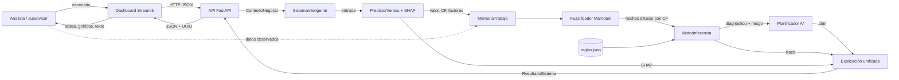

# Ingeniería del conocimiento: CommonKADS simplificado

Este documento aplica una versión simplificada de CommonKADS al sistema
inteligente híbrido del proyecto. CommonKADS describe un sistema basado en
conocimiento desde seis modelos complementarios: **organización, tareas,
agentes, conocimiento, comunicación y diseño**. La versión aquí presentada
mantiene la estructura y la trazabilidad de la metodología, pero reduce la
ceremonia documental a lo que es verificable en el repositorio.

> **Nota sobre las fuentes.** El proyecto no dispuso de expertos humanos reales.
> Las fuentes descritas en la sección 1 son **personas ficticias creadas para la
> simulación**, con nombres, roles y testimonios inventados. Sirven para hacer
> explícito de dónde se deriva cada regla y para reproducir el proceso de
> adquisición, pero **no constituyen evidencia empírica de una empresa real**.
> Los datos de ventas también son simulados y se generan con semilla fija en
> `data/generar_dataset.py`.

---

## 1. Adquisición del conocimiento

### 1.1 Fuentes simuladas

| Fuente simulada | Rol en la organización ficticia | Conocimiento aportado |
| --------------- | ------------------------------- | --------------------- |
| Ana Flores | Jefa de operaciones de la cadena (6 sucursales) | Causas operativas de la caída de ventas: quiebres de stock, merma en perecibles, dotación de personal. Reglas D01-D04, D10, A01, A02, A07, A08, A09, A10. |
| Carlos Mendoza | Analista de demanda y planeación | Relación entre temporada, feriados, afluencia, promociones y cumplimiento de meta. Reglas D05, D06, D08, D09, R01, R04, R06, A03, A06, A11. |
| Roxana Pérez | Supervisora de tienda en El Alto | Precio frente a la competencia, reasignación entre sucursales, señales de "operación crítica". Reglas D07, R02, R03, A04, A05, A12. |
| Luis Arce | Responsable de calidad y mermas | Efecto del calor y de la merma extrema sobre unidades vendibles. Reglas D04, R07, A07, A08. |
| Comité de dirección (simulado) | Dueño del problema de negocio | Definición de meta, presupuesto semanal y qué cuenta como "riesgo alto" o "urgencia de acción". Umbrales R01-R05, F01-F06. |

### 1.2 Técnicas de adquisición aplicadas

1. **Entrevista semiestructurada simulada.** Se redactaron guiones de preguntas
   para cada fuente, por ejemplo: *"¿Qué observa primero cuando una sucursal no
   llega a su meta?"*, *"¿Cuándo decide traer stock de otra tienda en lugar de
   pedir reposición?"*, *"¿Cómo describe usted un riesgo alto sin usar números?"*.
   Las respuestas ficticias se transformaron en condiciones y conclusiones.
2. **Observación de la tarea.** Se siguió el razonamiento de un supervisor ante
   tres escenarios (déficit, normal, exceso de inventario) y se anotó el orden en
   que revisaba las variables: primero cobertura de stock y merma, después
   cumplimiento esperado, luego afluencia/precio y finalmente la acción.
3. **Análisis de documentos simulados.** Se usaron formatos de "reporte semanal
   de sucursal" con columnas de meta, ventas, stock, merma, afluencia y
   promoción. Esos campos se convirtieron en los atributos de
   `ContextoNegocio` y en las variables lingüísticas de `config.py`.
4. **Revisión con el experto simulado.** Cada regla se validó con una contra-
   pregunta: *"¿ Esta conclusión seguiría siendo válida si el cumplimiento fuera
   96 %?"*. Las respuestas ajustaron los umbrales y los factores de certeza.
5. **Contraste con datos.** Las reglas se ejecutaron sobre el dataset simulado
   (`data/raw/ventas_semanales.csv`) para detectar reglas que nunca se disparaban
   o que contradecían el comportamiento del simulador.

### 1.3 Registro de adquisición

| Sesión | Fuente | Hallazgo principal | Regla resultante |
| ------ | ------ | ------------------ | ---------------- |
| S-01 | Ana Flores | "Si la cobertura baja del 35 % y además cae la venta, es falta de inventario, no falta de clientes." | D01 (FC 0.90) |
| S-02 | Luis Arce | "Con merma por encima del 12 % en perecibles, el pedido se recorta antes de promocionar." | D03, A08 |
| S-03 | Carlos Mendoza | "Por debajo del 85 % de la meta ya no es un aviso: es riesgo alto." | R01 (FC 0.95) |
| S-04 | Roxana Pérez | "Si el reabastecimiento tarda, se trae stock de otra sucursal que tenga excedente." | A10 (FC 0.84) |
| S-05 | Comité | "Riesgo es una palabra borrosa; 84 % y 86 % no se sienten igual." | Variables difusas en `config.py` |
| S-06 | Carlos Mendoza | "Cuando no hubo promoción ni feriado, la caída no se explica por demanda." | D05 (FC 0.78) |

### 1.4 Conversión a conocimiento formal

El resultado de la adquisición se materializa en tres artefactos:

- `expert_system/reglas.json`: 38 reglas declarativas con id, descripción,
  categoría, prioridad, factor de certeza, condiciones anidadas y conclusión.
- `config.py`: catálogos del dominio (sucursales, categorías, temporadas),
  umbrales, restricciones causa→operador y la definición de las siete variables
  lingüísticas y las 22 reglas del sistema difuso Mamdani.
- `core/contexto.py`: traducción de los datos observados a hechos tipados que
  alimentan la memoria de trabajo.

---

## 2. Modelo de organización

**Propósito de la organización ficticia.** Mantener el cumplimiento semanal de
la meta de ventas en seis sucursales bolivianas de cuatro categorías de
alimentos (pollo, cerdo, embutidos y congelados), con inventario suficiente y
merma controlada.

| Elemento | Descripción |
| -------- | ----------- |
| Objetivo principal | Cumplir o superar la meta semanal de cada sucursal/categoría. |
| Objetivos secundarios | Evitar quiebres de stock, reducir merma, usar el presupuesto de forma eficiente y explicar cada decisión. |
| Unidad de trabajo | Semana comercial de una sucursal y una categoría. |
| Entradas | Histórico de ventas, meta fijada antes de vender, stock inicial, merma, afluencia, personal, temperatura, promociones y feriados. |
| Salidas | Predicción de ventas, diagnóstico con certeza, nivel de riesgo, plan de acciones y explicación. |
| Restricciones | Presupuesto semanal, stock disponible, no vender más de lo disponible después de merma, perecibilidad y tiempos de reposición. |
| Problema actual | Las decisiones se toman por intuición, sin combinar la señal predictiva con el criterio del experto, y sin dejar traza explicable. |

**Oportunidad de mejora detectada.** Un modelo de regresión solo dice *cuánto*
se venderá; un experto dice *por qué* y *qué hacer*, pero no cuantifica la
duda. La organización necesita ambos puntos de vista y una justificación
auditable. De ahí surge el sistema híbrido descrito en este documento.

---

## 3. Modelo de tareas

### 3.1 Jerarquía de tareas

```text
T0 Analizar la semana comercial
├── T1 Predecir ventas de la semana objetivo
│   ├── T1.1 Construir ventana de lags y medias móviles
│   ├── T1.2 Aplicar pipeline Ridge calibrado
│   └── T1.3 Obtener factores SHAP y confianza
├── T2 Diagnosticar causas del incumplimiento
│   ├── T2.1 Registrar hechos observados con CF = 1.0
│   ├── T2.2 Registrar hechos del modelo con CF = confianza calibrada
│   ├── T2.3 Fuzzificar variables numéricas
│   └── T2.4 Encadenar reglas hacia adelante y ordenar causas por CF
├── T3 Graduar el riesgo
│   ├── T3.1 Ejecutar sistema Mamdani (riesgo y urgencia)
│   └── T3.2 Convertir etiquetas difusas en hechos simbólicos (reglas F01-F08)
├── T4 Planificar acciones
│   ├── T4.1 Derivar restricciones del diagnóstico (merma alta, exceso de stock, etc.)
│   └── T4.2 Resolver con A* sobre el espacio de estados comercial
└── T5 Explicar
    ├── T5.1 Explicar la predicción (SHAP)
    ├── T5.2 Explicar reglas, traza y certezas
    ├── T5.3 Explicar el riesgo difuso y el plan
    └── T5.4 Comparar razonamiento simbólico y no simbólico
```

### 3.2 Especificación de tareas principales

| Tarea | Entrada | Salida | Criterio de terminación |
| ----- | ------- | ------ | ----------------------- |
| T1 | `ContextoNegocio` con historial | `PrediccionVentas` con valor, confianza y factores | El pipeline devuelve un valor finito y la confianza está en [0, 1]. |
| T2 | Hechos + base de 38 reglas | `tuple[Causa, ...]` rankeado por CF | La memoria de trabajo queda sin reglas disparables o se agota el límite de pasos. |
| T3 | Cinco variables numéricas | `Riesgo` con etiqueta, pertenencia y urgencia | El sistema difuso desfuzzifica por centroide. |
| T4 | Meta, presupuesto, stock, causas | `Plan` con acciones, costo y nodos expandidos | A* alcanza la meta o agota la frontera con `encontrado=False`. |
| T5 | Predicción, traza, diagnóstico, riesgo y plan | Texto estructurado en cinco secciones | Se generan las cinco secciones de `explicacion_unificada`. |

### 3.3 Conocimiento de control

- Secuencia fija **T1 → T2 → T3 → T4 → T5**, implementada en
  `SistemaInteligente.ejecutar`.
- Si la meta ya se supera, T4 devuelve el plan vacío "sin acciones" y no se
  inventa una recomendación.
- Las causas con CF positivo se transforman en restricciones del plan; por
  ejemplo, `merma_alta` desactiva la reasignación y `exceso_stock` impide traer
  más inventario de otra sucursal (`RESTRICCIONES_CAUSA_OPERADOR`).
- La memoria de trabajo se reinicia por petición: no hay contaminación entre
  análisis de sucursales distintas.

---

## 4. Modelo de agentes

| Agente | Tipo | Rol | Conocimiento que posee | Comunica con |
| ------ | ---- | --- | ---------------------- | ------------ |
| Analista / supervisor | Humano | Formula el escenario y consume la explicación | Objetivos, umbrales informales, criterio de negocio | Dashboard, API |
| `PredictorVentas` | Software (no simbólico) | Predice ventas y confianza | Pesos Ridge, transformadores, fondo SHAP | Fachada |
| `BaseConocimientos` | Software (simbólico) | Almacena y valida las 38 reglas | Reglas, categorías, prioridades, FC | Motor, explicador |
| `MemoriaTrabajo` | Software |Estado compartido de hechos y traza | Hechos con CF, origen y justificación | Motor, fachada, explicador |
| `MotorInferencia` | Software (simbólico) | Encadenamiento hacia adelante y hacia atrás | Aritmética MYCIN, resolución de conflictos | Base, memoria, difuso |
| `SistemaDifuso` | Software (simbólico aproximado) | Fuzzificación y Mamdani | 7 variables, 22 reglas difusas, centroide | Motor, fachada |
| `core.planificador` | Software (búsqueda) | Resuelve el plan con A* | Operadores, costos, heurística admisible | Fachada |
| `SistemaInteligente` | Software (coordinador) | Orquesta el flujo | Procedimiento T0-T5 y contratos `core/puertos.py` | Todos los agentes internos |
| API FastAPI | Software (interfaz) | Expone HTTP y normaliza errores | Esquemas Pydantic, inyección por `app.state` | Dashboard, clientes |
| Dashboard Streamlit | Software (interfaz) | Visualiza y permite explorar | Solo presentación; llama a la API | Usuario, API |

**Distribución de responsabilidad.** Ningún agente conoce el trabajo de los
demás más allá de su interfaz: el motor ignora scikit-fuzzy, el predictor ignora
las reglas, la API ignora la lógica de negocio y el dashboard ignora el modelo.
Esto se garantiza con los `Protocol` de `core/puertos.py` y con la inyección de
dependencias en `core/fabrica.py` y `api/dependencias.py`.

---

## 5. Modelo de conocimiento

### 5.1 Tipos de conocimiento

| Tipo | Ejemplo | Representación | CF |
| ---- | ------- | -------------- | -- |
| Datos observados | `stock_cobertura = 0.18` | `Hecho` en memoria, origen `contexto` | 1.0 |
| Predicción | `prediccion_ventas_bs = 35740.90` | `Hecho`, origen `ml` | Confianza calibrada (p. ej. 0.24) |
| Derivado difuso | `nivel_stock = crítico` | `Hecho`, origen `difuso` | Grado de pertenencia |
| Regla crisp | D01: cobertura baja + caída ⇒ `stock_critico` | Objeto `Regla` en JSON | 0.90 |
| Regla difusa | F04: urgencia alta ⇒ reponer | Objeto `ReglaDifusa` en `config.py` | 0.85 |
| Procedimental | Orden de fases y resolución de conflictos | Código en `core/sistema.py` y `expert_system/motor_inferencia.py` | N/A |
| Explicativo | Plantillas "POR QUÉ / CÓMO" | `expert_system/explicacion.py` | N/A |

### 5.2 Aritmética de incertidumbre

El sistema usa factores de certeza estilo MYCIN, implementados en
`expert_system/factores_certeza.py`:

- `and` → `min(CF_i)`; `or` → `max(CF_i)`.
- Propagación: `CF_conclusión = CF_regla × CF_premisa`.
- Evidencia convergente: combinación de dos CF positivos, dos negativos o de
  signos opuestos según las fórmulas clásicas.
- Umbral de disparo por defecto: 0.2 (`UMBRAL_CF_EXPERTO`).

**Imprecisión versus incertidumbre.** La lógica difusa expresa *imprecisión*
(un cumplimiento del 82 % pertenece a "medio" y a "alto" en distinto grado);
el CF expresa *duda* ("creo con 0.8 que hay stock crítico"). La interfaz
`Fuzzificador` convierte el grado de pertenencia en CF para que el motor
crisp pueda usar reglas F01-F08 sin conocer scikit-fuzzy.

### 5.3 Base de conocimientos declarativa (38 reglas)

Las reglas se validan al cargar; un id duplicado, un operador desconocido o un
FC fuera de `[-1, 1]` detiene la carga. Categorías: `diagnostico` (10),
`riesgo` (8), `recomendacion` (12) y `difuso` (8).

| ID | Categoría | FC | Conocimiento expresado |
| -- | --------- | -- | ---------------------- |
| D01 | diagnostico | 0.90 | Cobertura baja y ventas caídas → falta de inventario |
| D02 | diagnostico | 0.95 | Desabastecimiento severo de perecible de alta rotación |
| D03 | diagnostico | 0.85 | Merma elevada en perecibles |
| D04 | diagnostico | 0.80 | El calor incrementa la merma |
| D05 | diagnostico | 0.78 | Sin promoción ni feriado: falta de estímulo comercial |
| D06 | diagnostico | 0.86 | Afluencia por debajo del promedio de la sucursal |
| D07 | diagnostico | 0.82 | Precio por encima de la competencia sin promoción |
| D08 | diagnostico | 0.75 | Temporada baja con inventario suficiente |
| D09 | diagnostico | 0.70 | Temporada alta sin promoción/cliente no compra |
| D10 | diagnostico | 0.88 | Desabastecimiento extremo o merma descontrolada → operación crítica |
| R01 | riesgo | 0.95 | Cumplimiento esperado < 85 % → riesgo alto |
| R02 | riesgo | 0.88 | Causa operativa con cumplimiento < 95 % agrava riesgo |
| R03 | riesgo | 0.82 | Causa de demanda o competencia amenaza la meta |
| R04 | riesgo | 0.75 | Cumplimiento 90-100 % → riesgo medio |
| R05 | riesgo | 0.85 | Cumplimiento adecuado y stock sano → riesgo bajo |
| R06 | riesgo | 0.78 | Temporada alta sin promoción y meta ajustada |
| R07 | riesgo | 0.85 | Merma extrema en perecibles con meta en riesgo |
| R08 | riesgo | 0.90 | Meta superada, merma controlada y stock suficiente → sin riesgo |
| A01 | recomendacion | 0.95 | Reposición urgente ante desabastecimiento y riesgo alto |
| A02 | recomendacion | 0.80 | Reponer antes de que la cobertura crítica se agrave |
| A03 | recomendacion | 0.92 | Lanzar promoción sin estímulo y con meta en riesgo |
| A04 | recomendacion | 0.86 | Promoción defensiva frente a precio de la competencia |
| A05 | recomendacion | 0.85 | Reforzar personal con mucha afluencia y dotación baja |
| A06 | recomendacion | 0.80 | Reforzar turnos en temporada alta con feriado |
| A07 | recomendacion | 0.90 | Reducir pedido de perecibles con merma alta en temporada baja |
| A08 | recomendacion | 0.88 | Merma extrema: recortar de inmediato el pedido |
| A09 | recomendacion | 0.87 | Reasignar inventario desde sucursal con excedentes |
| A10 | recomendacion | 0.84 | Si el reabastecimiento tarda, traer stock de otra sucursal |
| A11 | recomendacion | 0.80 | Riesgo bajo y stock suficiente → mantener plan de compras |
| A12 | recomendacion | 0.78 | Ajustar precios ante competencia con riesgo controlado |
| F01 | difuso | 0.90 | Riesgo difuso crítico → escalar a riesgo alto |
| F02 | difuso | 0.80 | Riesgo difuso alto → confirmar riesgo alto |
| F03 | difuso | 0.70 | Riesgo difuso bajo → respaldar riesgo bajo |
| F04 | difuso | 0.85 | Urgencia difusa alta → reponer de inmediato |
| F05 | difuso | 0.70 | Urgencia difusa media → promoción correctiva |
| F06 | difuso | 0.75 | Urgencia difusa nula → mantener plan de compras |
| F07 | difuso | 0.88 | Merma fuzzificada alta + urgencia máxima → recortar pedido |
| F08 | difuso | 0.82 | Stock fuzzificado crítico + urgencia máxima → reasignar |

### 5.4 Modelo difuso

Entradas: `cumplimiento_esperado`, `nivel_stock`, `merma`, `afluencia` e
`intensidad_promocion`. Salidas: `nivel_riesgo_incumplimiento` y
`urgencia_accion`. Las funciones de pertenencia triangulares/trapezoidales, los
universos, las 22 reglas y el mapeo de hechos numéricos a variables lingüísticas
están declarados en `config.py` y construidos en
`expert_system/logica_difusa.SistemaDifuso`. La defuzzificación es por centroide.

### 5.5 Estrategia de inferencia y explicación

1. Encadenamiento **hacia adelante** con resolución de conflictos por
   prioridad, especificidad e id, para construir un diagnóstico a partir de los
   hechos disponibles.
2. Encadenamiento **hacia atrás** opcional para demostrar un subobjetivo y
   formular preguntas al proveedor de datos cuando falta información.
3. Traza de cada disparo con regla, condiciones, CF de premisa, CF propagado y
   conclusión. `expert_system/explicacion.explicar` produce respuestas
   "POR QUÉ / CÓMO" a partir de esa traza.
4. `core/explicacion.explicacion_unificada` añade la explicación SHAP, el
   riesgo difuso, la justificación de A* y la comparativa Tema 1.

---

## 6. Modelo de comunicación



| Flujo | Emisor → receptor | Formato | Momento |
| ----- | ----------------- | ------- | ------- |
| Escenario | Usuario → dashboard → API | `SolicitudAnalisis` (Pydantic) | Al pulsar "Analizar". |
| Datos | API → fachada → memoria | `ContextoNegocio`, `Hecho` | Inicio de `ejecutar`. |
| Predicción | Predictor → memoria | `PrediccionVentas` + CF | Tras el modelo. |
| Fuzzificación | SistemaDifuso → memoria | Hechos con CF = pertenencia | Antes del motor. |
| Inferencia | Motor → memoria/traza | Hechos derivados, `TrazaInferencia` | En cada disparo. |
| Plan | Planificador → resultado | `Plan` con acciones y costo | Tras el diagnóstico. |
| Explicación | Fachada → API → dashboard | `ResultadoSistema` / JSON | Al terminar la petición. |
| Recuperación | API → repositorio en memoria | UUID → análisis guardado | `GET /explicar/{id}`. |

**Protocolos.** HTTP/JSON con FastAPI y Pydantic estricto en la frontera;
dentro del proceso, llamadas a métodos con contratos `Protocol` y objetos
inmutables. CORS se limita a los orígenes del dashboard. No existen globales
mutables: la API crea una fachada nueva por petición porque la memoria
acumula estado.

---

## 7. Modelo de diseño

| Decisión de conocimiento | Realización en software |
| ------------------------ | ----------------------- |
| Reglas separadas del código | `expert_system/reglas.json`, cargadas y validadas en `BaseConocimientos.desde_json` |
| Motor independiente del dominio | `expert_system/motor_inferencia.MotorInferencia` solo conoce `Regla`, `Hecho` y CF |
| Imprecisión encapsulada | `expert_system/logica_difusa.SistemaDifuso` detrás del protocolo `Fuzzificador` |
| Fusión ML + símbolico | `core/sistema.SistemaInteligente.ejecutar` y `core/contexto.ContextoNegocio` |
| Búsqueda parametrizada por el diagnóstico | `core/planificador.Planificador` y `RESTRICCIONES_CAUSA_OPERADOR` |
| Explicación auditable | `expert_system/explicacion.py` + `core/explicacion.py` |
| Acceso remoto | `api/main.py:crear_app`, `api/dependencias.py`, `api/esquemas.py` |
| Presentación | `app/dashboard.py` (cliente HTTP, sin lógica de negocio) |

**Restricciones de implementación.**

- Python 3.11, dependencias fijadas en `requirements.txt` y
  `requirements-dev.txt`.
- Semilla 2026 para dataset y entrenamiento: los resultados son reproducibles.
- El pipeline Ridge usa corte temporal (entrenamiento hasta 2025-06-30), sin
  fuga de información.
- La heurística de A* es admisible y consistente; se verifica contra costo
  uniforme en `docs/benchmark_busqueda.md`.
- Cubierta de pruebas superior al 80 % en los paquetes `expert_system/` y
  `search/`; ver `docs/informe.md`.

**Mantenimiento previsto.** Para añadir una regla basta un nuevo objeto en
`reglas.json` con id único; las pruebas de carga validan su forma. Para cambiar
una etiqueta difusa se edita `config.py` y se regeneran las figuras de
pertenencia. Cualquier cambio de umbral debe ir acompañado de una ejecución de
`python -m core.demo` y de la batería `pytest`.

---

## 8. Validación y limitaciones del modelo de conocimiento

- **Validación interna:** 262 pruebas automáticas, incluidas pruebas de carga
  de reglas, aritmética de CF, trazas, difuso, búsqueda, integración y API.
- **Validación de optimalidad:** A* y costo uniforme coinciden en los seis
  escenarios del benchmark con solución.
- **Validación de contradicciones:** el demo de `expert_system.demo` muestra el
  mismo caso con y sin lógica difusa para comparar justificaciones.
- **Limitación principal:** los expertos, las entrevistas y los datos son
  simulados. Los umbrales y FC reflejan criterios plausiblemente razonables,
  no una elicitación real. Antes de usar el sistema en una operación real
  haría falta repetir las sesiones S-01 a S-06 con personal de la cadena y
  recalibrar reglas con datos históricos auténticos.
